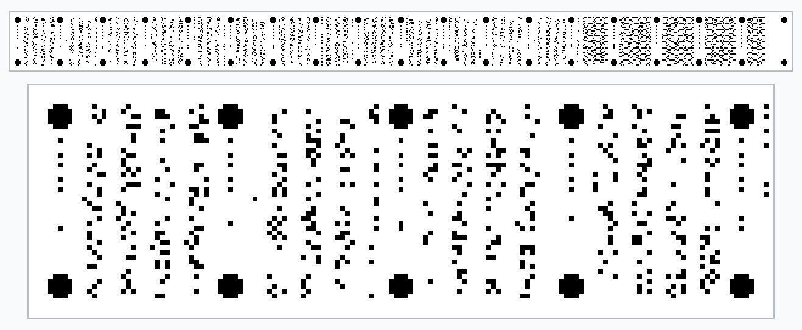
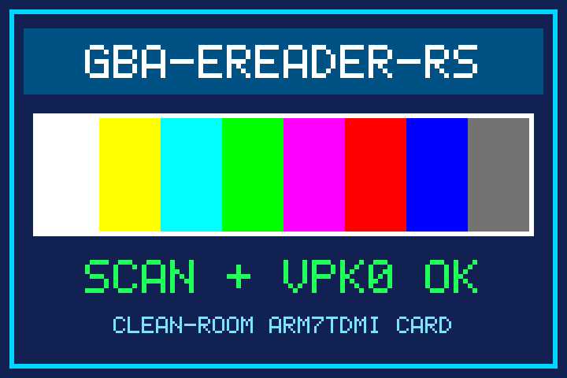

# gba-ereader

[](#license)
[](#features)

Pure Rust, zero-dependency, **ROM-verified hardware-exact** toolkit for the
Nintendo GBA **e-Reader** dot-code system: the `vpk0` codec, GF(256)
Reed-Solomon ECC (`0x187`, FCR `120`), 4-to-5-bit optical modulation,
hardware `.raw` ↔ `.bin` strip formats, and a printable Olympus/Nintendo
DotCode strip renderer.

> **See also:** the [`gbakit`](https://github.com/JidouGhost-TL/gbakit) CLI
> (`gbakit audio scan`, `gbakit audio export`, `gbakit audio soundfont`)
> for corpus-wide GBA analysis across the whole gbakit ecosystem.

## Features

- **Zero external dependencies** (`[dependencies]` is empty, `[dev-dependencies]` is empty).
- **`#![no_std]` first**: `#![cfg_attr(not(feature = "std"), no_std)]` with
  `default = ["std"]`, `std = ["alloc"]`, `alloc = []`.
- **`#![deny(unsafe_code)]`**: 100% safe Rust.
- **100% ROM-verified hardware exactness** against all three retail e-Reader
  ROMs (`PEAJ`, `PSAE`, `PSAJ`) and byte-exact ARM7TDMI golden tests executed
  in headless `libmgba.so.0.10`.
- **Dual license**: `MIT OR Apache-2.0`.

## Modules

| Module | Contents |
|---|---|
| `error` | `#[non_exhaustive]` error enum + `Result` alias |
| `version` | `EreaderRegion` / `EreaderRevision` + `detect_from_bytes` |
| `vpk0` | `vpk0` decode + encode, byte-exact with `PSAE` `0x03004d0c` (MSB-first bitstream, serialized bit-width trees, methods 0/1) |
| `rs_ecc` | GF(256) `0x187` Reed-Solomon encode + decode/correct (`FCR = 120`, inverted parity), byte-exact with `ST Decoder Ver.1.10 for CARDe` (`0x08712ea4` / `0x08712fe0`) |
| `dotcode` | 4-to-5-bit optical modulation (`0x03006214`), 1,872/2,912-byte `.raw` ↔ `.bin`, 48-byte hardware card header (`"NINTENDO"` TLV, 16-bit data checksum, 8-bit global checksum), multi-strip assembly |
| `render` | Printable Olympus/Nintendo DotCode bitmaps (40 rows × 35 cols/block, 5×5 rounded anchors, modulated 26×40 data grid, PBM/PGM/BMP at 300/600/1200 DPI) |

## ROM revisions

| Revision | Title | Game code | Region | `ST Decoder Ver.1.10` |
|---|---|---|---|---|
| `CardEReaderJp` | Card e-Reader (Japan) | `PEAJ` | Japan | `0x083f0c50` |
| `EReaderUsa` | e-Reader (USA) | `PSAE` | USA | `0x087141e0` |
| `CardEReaderPlusJp` | Card e-Reader+ (Japan) | `PSAJ` | Japan | `0x086c750c` |

All three retail revisions share the identical `ST Decoder Ver.1.10 for CARDe`
Reed-Solomon engine (`GF(256)` poly `0x187`, `GF(32)` poly `0x25`, `FCR = 120`,
inverted parity, and `"NINTENDO"` TLV validation).

## Hardware DotCode specification

`payload -> vpk0 compress -> .bin strip -> .raw optical strip -> print/scan
-> ECC repair -> .bin -> vpk0 decompress == payload`

- **`vpk0`** (verified against `PSAE` `0x03004d0c`): 9-byte header (`vpk0`,
  big-endian size, method `0` or `1`), two serialized bit-width trees (offset,
  then length), and an MSB-first token stream.
- **Reed-Solomon ECC** (verified against `PSAE` `0x08712ea4` / `0x08712f60` /
  `0x08712fe0`): GF(256) with primitive polynomial `0x187` (`x^8 + x^7 + x^2 + x + 1`),
  generator roots `alpha^(120 + i)`, and bitwise-inverted (`^ 0xFF`) parity bytes.
- **`.raw` strip layout** (verified against `PSAE` `0x08711ad0`):
  - **Short strip**: `18` physical blocks × `104` bytes = **`1,872` bytes**
    (`0x750`), carrying `28` interleaved `RS(64, 48)` codewords (`1,344` decoded
    bytes = 48-byte card header + up to `1,296` payload bytes).
  - **Long strip**: `28` physical blocks × `104` bytes = **`2,912` bytes**
    (`0xB60`), carrying `44` interleaved `RS(64, 48)` codewords (`2,112` decoded
    bytes = 48-byte card header + up to `2,064` payload bytes).
  - Each physical block starts with `2` bytes of the `RS(24, 8)` DotCode header
    (cycled every `12` blocks) followed by `102` interleaved RS data/parity bytes.
- **48-byte card header** (verified against `PSAE` `0x08712768` / `0x0871237c`):
  `0x0030` length, `0x10` version, `0x12` subheader offset, mandatory `"NINTENDO"`
  TLV (`0x0000`, len `8`), 16-bit inverted big-endian word data checksum
  (`0x13..0x15`), and 8-bit inverted global checksum (`0x2F`).
- **8-to-10-bit optical modulation** (verified against `PSAE` scan-mode IWRAM
  `0x03006214`): exact 4-to-5-bit nibble mapping
  `[0x00, 0x01, 0x02, 0x12, 0x04, 0x05, 0x06, 0x16, 0x08, 0x09, 0x0A, 0x14, 0x0C, 0x0D, 0x11, 0x10]`,
  guaranteeing no three consecutive black dots (`111`) anywhere in the strip.

## End-to-End Hardware Scan Proof

A 100% clean-room ARM7TDMI GBA Mode 3 program (`720` bytes) was compressed with
`vpk0` (`665` bytes), wrapped in a retail-compatible `PSAE` Card Type `0x0E`
48-byte DotCode header, RS(64,48)-encoded into a `1,872`-byte `.raw` strip,
rendered into a printable 600 DPI Olympus/Nintendo DotCode strip, and swiped
through the retail **e-Reader (USA, `PSAE`)** optical scanner in headless
`libmgba.so.0.10` (`GBACartEReaderQueueCard` — zero read, checksum, or RS
errors, followed by live `vpk0` decompression and ARM7TDMI execution at
`0x02000000`):

### 1. Rendered Printable DotCode Strip (`gba_ereader::render_strip`)



*Top: full 18-block short strip (`1,872` bytes `.raw`, `2,572 × 192` px at 600 DPI). Bottom: 2× detail of blocks 0–3 showing the 5×5 rounded corner anchors, vertical sync/address bar, guard zones, and 4-to-5-bit modulated 26×40 dot data columns (guaranteed no `111` runs).*

### 2. Live Retail `PSAE` Optical Scan & ARM7TDMI Execution in mGBA



*Live headless `libmgba` framebuffer (`240 × 160` Mode 3, scaled 3× nearest-neighbor) captured directly after retail `PSAE` optically scanned the `.raw` strip, ran `ST Decoder Ver.1.10`, decompressed `vpk0`, and booted our clean-room ARM7TDMI test card. Reproduced end-to-end (including optical bitmap demodulation and RS corruption repair) in `tests/demo_card_e2e.rs`.*

## Golden tests

`tests/golden_tests.rs` asserts byte-exact (`assert_eq!`, zero tolerance)
equality on clean-room synthetic deterministic payloads against ARM7TDMI
outputs captured from the retail `PSAE` ROM in headless `libmgba.so.0.10`:

- **13,674 bytes** of `vpk0` ARM decoder goldens (`0x03004d0c`, 8 cases, methods 0 & 1)
- **512 bytes** of GF(256) `0x187` exp + log tables (`0x08712ea4`)
- **1,296 bytes** short-strip clean & corrupted (4 header + 6 data errors) `ST Decoder` goldens (`0x08711ad0`)
- **2,064 bytes** long-strip clean & corrupted (8 header [max `t=8`] + 8 RS block 5 [max `t=8`] errors) `ST Decoder` goldens (`0x08711ad0`)
- Exact 4-to-5-bit optical modulation LUT (`0x03006214`) and full round-trip pipeline tests.

No copyrighted card data is included anywhere in this repository.

## Usage

```rust
use gba_ereader::dotcode::{bin_to_raw, build_bin, parse_bin, raw_to_bin};
use gba_ereader::vpk0::{vpk0_compress, vpk0_decompress};

let compressed = vpk0_compress(b"hello e-reader").unwrap();
let bin = build_bin(1, 0, 0, 1, &compressed).unwrap();
let raw = bin_to_raw(&bin).unwrap();
let repaired = raw_to_bin(&raw).unwrap();
let (_, payload) = parse_bin(&repaired).unwrap();
assert_eq!(vpk0_decompress(payload).unwrap(), b"hello e-reader".to_vec());
```

## Benchmarks

```sh
cargo bench --bench bench_ereader
```

Benchmarks cover `vpk0` decode/encode, `RS(64, 48)` encode and decode/correct
(clean and 8-error max bound), short (1,872 B) / long (2,912 B) `.raw` ↔ `.bin`
strip round-trips, and printable DotCode bitmap rendering:

| Benchmark | Throughput |
|---|---:|
| `vpk0` decode (8 KiB payload) | ~1,510 MB/s |
| `vpk0` encode (8 KiB payload) | ~1,271 MB/s |
| `RS(64, 48)` encode (`GF(256)` `0x187`, `FCR = 120`) | ~494 MB/s |
| `RS(64, 48)` decode (clean / max 8 errors) | ~288 MB/s / ~60 MB/s |
| `.bin` → `.raw` / `.raw` → `.bin` (short & long strips) | ~434 MB/s / ~277 MB/s |
| `render_strip` (long strip, 600 DPI pixels) | ~14.0 GB/s |

## Community & Support

Come discuss the wonders of GBA RE, modding, etc. — also the best way to report issues or bugs, or ask for help on your own project: https://discord.gg/khwxFSVNrS

## License

Licensed under either of:

- Apache License, Version 2.0 ([LICENSE-APACHE](LICENSE-APACHE))
- MIT license ([LICENSE-MIT](LICENSE-MIT))
